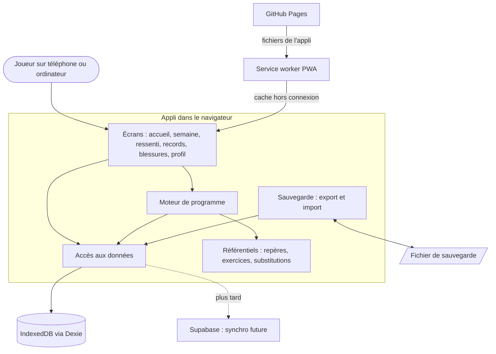

# INSTALL.md - Appli prépa rugby (nom provisoire)

Vision technique et guide d'installation.

> Besoins produit : [prd.md](tasks/2026_10/2026_10_01_appli-prepa-rugby/prd.md). Veille scientifique : [etat-de-l-art-prepa-rugby.md](tasks/2026_10/2026_10_01_appli-prepa-rugby/etat-de-l-art-prepa-rugby.md).

## Vision

Un programme de prépa physique qui s'adapte à la charge réelle du club et des matchs, pour rugbymen et rugbywomen adultes.

L'appli génère chaque semaine les séances de musculation, de course et de récupération d'un joueur ou d'une joueuse de rugby à XV, autour de ses entraînements du club et de ses matchs. Elle tient compte de son poste, de son ressenti, de ses minutes jouées, de ses records et de ses blessures. Son point fort est l'**intégration de la charge du club**.

La première version vise une dizaine de coéquipiers. Elle s'installe depuis un lien, fonctionne sans réseau et garde toutes les données sur l'appareil du joueur.

## Decisions

| Décision | Choix | Pourquoi |
| --- | --- | --- |
| Architecture | Application monolithique **100 % navigateur**, hors connexion d'abord, sans serveur | Une dizaine d'utilisateurs, aucun temps réel, budget gratuit. Le hors connexion est exigé en salle de musculation. Sans serveur, il n'y a ni synchronisation à écrire, ni hébergement de données de santé |
| Écran | React + Vite en TypeScript, installable comme une appli (PWA via vite-plugin-pwa) | Un site installable s'écrit forcément en JavaScript ou TypeScript. L'écosystème PWA est le plus mûr, et le typage rassure quand on vient de Java ou de C# |
| Serveur | Aucun en première version | Données locales. La synchronisation entre appareils est reportée à une version ultérieure |
| Base de données | IndexedDB dans le navigateur, via Dexie.js, avec sauvegarde par fichier | Stockage local fiable et hors connexion. Identifiants uniques et date de modification sur chaque donnée, pour préparer la synchronisation future |
| Connexion | Aucune en première version (profil local). Supabase Auth envisagé avec la synchronisation | Sans compte, pas de mot de passe à gérer. La piste Supabase a été vérifiée et jugée viable sous conditions |
| Hébergement | GitHub Pages (dépôt public sur le compte Git de l'école), publié automatiquement par GitHub Actions | Gratuit et sans carte bancaire. Il suffit de partager un lien. Le code est public, mais aucune donnée de joueur n'est dans le dépôt |

## Stack summary

- **Écran :**
  - Node.js 22 LTS (déjà installé sur le poste), TypeScript, React, Vite, vite-plugin-pwa (Workbox) ;
  - **les versions sont à figer à l'installation**, en vérifiant que vite-plugin-pwa accepte la version de Vite choisie (incompatibilité signalée avec Vite 8 en mars 2026, ticket vite-pwa #923).
- **Serveur :** aucun.
- **Base de données :**
  - Dexie.js 4 sur IndexedDB ;
  - stockage persistant demandé au navigateur (`navigator.storage.persist()`) ;
  - export et import de la sauvegarde en fichier JSON.
- **Connexion :** aucune (profil local).
- **Hébergement :** GitHub Pages (offre gratuite, dépôt public) et un workflow GitHub Actions de publication.
- **Services externes :** aucun en première version. Supabase est prévu plus tard pour les comptes et la synchronisation.

## Architecture



Tout tourne dans le navigateur. GitHub Pages ne sert que les fichiers de l'appli, que le service worker garde en cache pour le hors connexion. Le **moteur de programme** est isolé des écrans. Il lit les **référentiels**, qui sont des données sourcées dans la veille et modifiables sans toucher au code, ainsi que les données du joueur. Ses règles se testent donc sans interface. Seule la couche **accès aux données** parle à IndexedDB : c'est elle que l'on branchera sur Supabase quand la synchronisation arrivera.

## Folder structure

```
appli-prepa-rugby/
├── .github/
│   └── workflows/
│       └── deploy.yml          # publie l'appli sur GitHub Pages à chaque mise à jour
├── public/
│   ├── icons/                  # icônes de l'appli installée
│   └── robots.txt
├── src/
│   ├── main.tsx                # point d'entrée
│   ├── App.tsx                 # navigation entre les écrans
│   ├── pwa/                    # installation, mode hors connexion, stockage persistant
│   ├── screens/                # un dossier par écran
│   │   ├── home/               # accueil : séance du jour, ressenti, progression
│   │   ├── week/               # vue de la semaine
│   │   ├── session/            # séance en cours, saisie des charges
│   │   ├── checkin/            # ressenti du matin, note après club ou match, minutes jouées
│   │   ├── records/            # records et courbes de progression
│   │   ├── injuries/           # déclaration et guérison des blessures
│   │   ├── profile/            # profil, calendrier du club, sauvegarde
│   │   └── onboarding/         # premier lancement
│   ├── components/             # éléments d'interface réutilisables
│   ├── engine/                 # moteur de programme, sans interface
│   │   ├── week-builder/       # place les séances autour du club et du match
│   │   ├── load/               # charge, seuils d'alerte, allègement
│   │   ├── weaknesses/         # comparaison au niveau du dessus
│   │   ├── injuries/           # exclusion et substitution d'exercices
│   │   └── progression/        # niveau, 1RM estimé, semaines allégées
│   ├── data/                   # accès aux données
│   │   ├── db.ts               # base locale Dexie (identifiants uniques + date de modification)
│   │   ├── repositories/       # lecture et écriture par type de donnée
│   │   └── backup/             # export et import de la sauvegarde
│   ├── reference/              # données de référence sourcées dans la veille
│   │   ├── norms/              # repères par ligne, sexe et niveau
│   │   ├── exercises/          # bibliothèque d'exercices et zones sollicitées
│   │   └── substitutions/      # table blessure → exercices exclus et substituts
│   └── types/                  # types partagés
├── tests/                      # tests du moteur et des données
├── index.html
├── package.json
├── tsconfig.json
└── vite.config.ts              # configuration Vite + PWA
```

## Install steps

Installation manuelle : le framework ne génère pas encore ces éléments automatiquement.

1. **Vérifier les outils du poste :**
   - Node.js 22 LTS et npm (déjà présents) ;
   - Git (déjà présent) ;
   - un éditeur, par exemple VS Code.
2. **Créer le projet Vite** avec le modèle React + TypeScript, puis ajouter vite-plugin-pwa, Dexie.js et un outil de test (par exemple Vitest). **Figer des versions compatibles** entre Vite et vite-plugin-pwa.
3. **Configurer l'appli :**
   - le manifeste PWA (nom, icônes, couleurs, affichage en plein écran) ;
   - le chemin de base de Vite sur le nom du dépôt, nécessaire pour GitHub Pages ;
   - la demande de stockage persistant au premier lancement.
4. **Créer le dépôt public sur le compte Git de l'école**, et non sur le compte actuellement connecté sur le poste. Pousser le projet **uniquement quand l'auteur le décide**.
5. **Activer GitHub Pages** dans les réglages du dépôt, avec GitHub Actions comme source. Ajouter le workflow `deploy.yml`, qui construit l'appli et la publie à chaque mise à jour de la branche principale.
6. **Tester l'installation :** ouvrir le lien publié dans Safari sur iPhone et faire « Partager → Sur l'écran d'accueil », de même sur Android avec Chrome. Couper le réseau et vérifier que l'appli s'ouvre toujours.
7. **Partager le lien** avec les coéquipiers testeurs, en leur demandant d'installer l'appli sur l'écran d'accueil et de faire une sauvegarde régulière.

## Audit summary

Résultats de la vérification menée en parallèle pendant le choix des technologies :

| Proposition | Verdict | Notes |
| --- | --- | --- |
| A. Tout TypeScript + Supabase | ⚠️ | Briques matures, connexion et sécurité fournies, 0 € réaliste. Mise en pause après 7 jours sans activité (contournable par une tâche automatique), pas de sauvegarde incluse, synchronisation hors connexion à écrire |
| B. TypeScript + serveur Python (FastAPI) | ⚠️ | Briques éprouvées. Le serveur gratuit s'endort (environ 1 min de réveil) et la base aussi. fastapi-users n'évolue plus, donc connexion à écrire soi-même. Deux langages |
| C. Tout en C# (Blazor + ASP.NET Core) | ⚠️ | Serveur et connexion très matures. Premier chargement lourd (plusieurs Mo), moins d'une seconde impossible au premier lancement. Peu d'outils hors connexion maintenus, même réveil lent du serveur gratuit |
| **Retenu : variante locale de A** | ⚠️ maîtrisé | Pas de serveur, données sur l'appareil, GitHub Pages. Risques et parades : effacement des données par Safari (installation + stockage persistant + rappel de sauvegarde à 14 jours), versions Vite et PWA à figer, dépôt public sans données. Supabase reste la piste pour la synchronisation |
