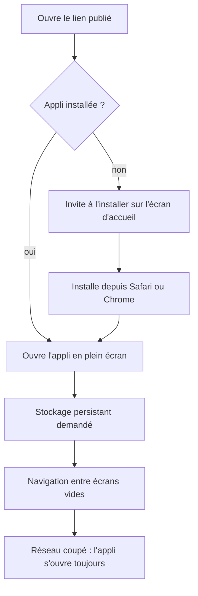
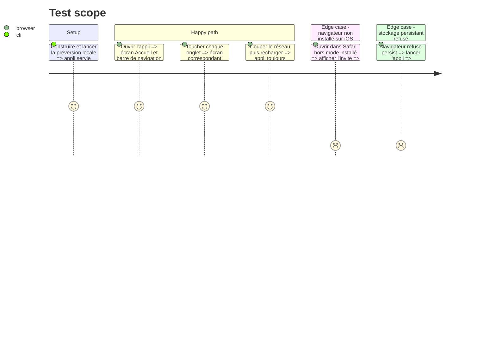

# Instruction: Socle PWA installable et hors connexion

## Architecture projection

> Tree of the final files. ✅ create · ✏️ modify · ❌ delete

```txt
.
├── .github/workflows/deploy.yml   ✅ build + publication GitHub Pages (non poussé)
├── .gitignore                     ✅ node_modules, dist, coverage
├── README.md                      ✅ lancer, tester, construire, installer sur téléphone
├── index.html                     ✅ point d'entrée HTML, meta PWA iOS
├── package.json                   ✅ scripts dev/build/preview/test/lint, versions figées
├── tsconfig.json                  ✅ TypeScript strict
├── vite.config.ts                 ✅ React + vite-plugin-pwa + base GitHub Pages + Vitest
├── public/
│   ├── icons/                     ✅ icônes 192, 512, maskable, apple-touch
│   └── robots.txt                 ✅ noindex
├── src/
│   ├── main.tsx                   ✅ montage React + enregistrement PWA
│   ├── App.tsx                    ✅ routes vides des écrans + barre de navigation
│   ├── components/NavBar.tsx      ✅ Accueil · Semaine · Records · Réglages
│   ├── styles/                    ✅ base CSS mobile d'abord, thème sombre rouge et noir
│   └── pwa/
│       ├── registerPwa.ts         ✅ enregistrement du service worker, mise à jour
│       ├── persistStorage.ts      ✅ demande de stockage persistant
│       └── InstallHint.tsx        ✅ invite « Ajouter à l'écran d'accueil » (iOS/Android)
└── tests/setup.ts                 ✅ config Vitest (jsdom, fake-indexeddb)
```

## User Journey



## Test Scope



## Tasks to do

### `1)` Initialiser le projet

> Projet Vite React TypeScript qui démarre et se teste, à la racine de `Appli/`.

1. Créer le projet Vite (modèle React + TS) sans écraser `aidd_docs/`.
2. Ajouter vite-plugin-pwa, Dexie, dexie-react-hooks, react-router, Vitest, jsdom, fake-indexeddb, ESLint.
3. Figer les versions exactes dans `package.json` (Vite 8.x compatible vite-plugin-pwa 1.3.x).
4. Scripts `dev`, `build`, `preview`, `test`, `lint`.
5. Ne lancer **aucune** commande Git.

### `2)` Rendre l'appli installable et hors connexion

> Manifeste, icônes et précache de tous les fichiers de l'appli.

1. Configurer le manifeste : nom provisoire, `display: standalone`, couleurs, icônes.
2. Précache Workbox de la SPA et repli de navigation sur `index.html`.
3. Meta iOS (`apple-touch-icon`, `apple-mobile-web-app-capable`).
4. Mise à jour du service worker avec message « nouvelle version disponible ».

### `3)` Protéger les données locales

> Réduire le risque d'effacement par Safari.

1. Appeler `navigator.storage.persist()` au premier lancement et mémoriser le résultat.
2. Afficher l'invite d'installation quand l'appli n'est pas en mode installé.

### `4)` Ossature de navigation

> Écrans vides prêts à être remplis par les phases suivantes.

1. Routes : accueil, semaine, séance, ressenti, records, blessures, profil, premier lancement.
2. Barre de navigation basse sur mobile, latérale sur grand écran.
3. Base CSS mobile d'abord, en thème sombre unique rouge et noir (décision du 2026-10-02, qui remplace le thème clair/sombre).

### `5)` Préparer la publication sans la déclencher

> Le workflow existe mais rien n'est poussé.

1. `base` Vite lu depuis une variable (nom du dépôt) avec repli `/`.
2. `deploy.yml` : build puis publication GitHub Pages sur la branche principale.
3. README : lancer, tester, construire, installer sur iPhone et Android, publier (étapes manuelles de l'auteur).

## Test acceptance criteria

| Task | Acceptance criteria |
| ---- | ------------------- |
| 1 | `npm run dev`, `npm run build`, `npm test` et `npm run lint` réussissent ; aucun dépôt Git n'a été créé |
| 2 | En préversion, le navigateur reconnaît l'appli comme installable et elle s'ouvre réseau coupé |
| 3 | Le résultat de la demande de stockage persistant est mémorisé ; l'invite d'installation n'apparaît qu'hors mode installé |
| 4 | Chaque onglet affiche son écran, sur téléphone comme sur ordinateur |
| 5 | Un build avec la variable de base produit des chemins corrects pour un sous-dossier ; `deploy.yml` est présent et non exécuté |
