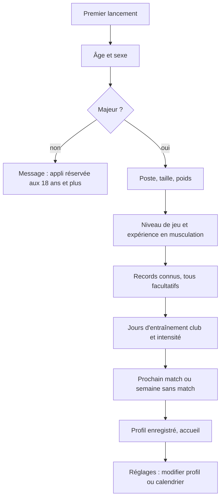
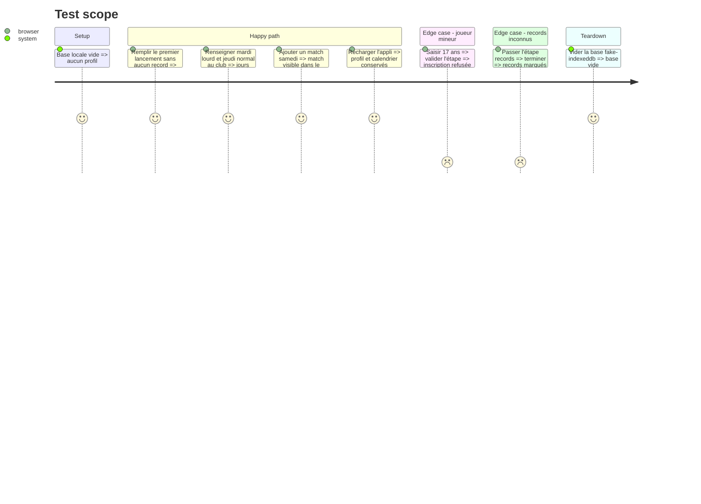

# Instruction: Données locales, premier lancement et calendrier club

## Architecture projection

> Tree of the final files. ✅ create · ✏️ modify · ❌ delete

```txt
.
├── src/
│   ├── App.tsx                          ✏️ redirige vers le premier lancement si aucun profil
│   ├── types/
│   │   ├── profile.ts                   ✅ sexe, âge, poste, ligne, niveau, expérience muscu, taille, poids
│   │   ├── calendar.ts                  ✅ jours club (lourd/normal), matchs datés, semaine sans match
│   │   └── records.ts                   ✅ type de test, valeur, unité, date, reps
│   ├── data/
│   │   ├── db.ts                        ✅ base Dexie versionnée, champs id/updatedAt/deletedAt
│   │   ├── ids.ts                       ✅ UUID et horodatage
│   │   └── repositories/
│   │       ├── profileRepo.ts           ✅ lire/écrire le profil
│   │       ├── calendarRepo.ts          ✅ jours club récurrents, matchs ponctuels
│   │       └── recordsRepo.ts           ✅ ajout et liste des records
│   └── screens/
│       ├── onboarding/                  ✅ parcours en étapes : identité, poste, niveau, records connus, club
│       └── profile/                     ✅ modifier profil et calendrier
└── tests/
    ├── data/repositories.test.ts        ✅ CRUD sur fake-indexeddb
    └── screens/onboarding.test.tsx      ✅ refus des mineurs, records facultatifs
```

## User Journey



## Test Scope



## Tasks to do

### `1)` Base locale

> Schéma Dexie versionné, prêt pour la synchronisation future.

1. Tables profil, calendrier (jours club, matchs), records, avec `id` UUID, `updatedAt`, `deletedAt`.
2. Suppression logique via `deletedAt`, jamais physique.
3. Dépôts typés par table, seuls points d'accès à Dexie.

### `2)` Premier lancement

> Parcours court en étapes, en moins de 5 minutes.

1. Étapes : âge et sexe, poste (ligne déduite), taille et poids, niveau de jeu, expérience en musculation, records connus, calendrier club.
2. Refuser un âge inférieur à 18 ans.
3. Tous les records facultatifs, saisie en charge × reps ou en temps.
4. Rediriger vers le premier lancement tant qu'aucun profil n'existe.

### `3)` Calendrier club et matchs

> Le socle sur lequel le moteur placera les séances.

1. Jours d'entraînement club récurrents, chacun marqué lourd ou normal.
2. Matchs ponctuels datés, et option « semaine sans match ».
3. Écran réglages pour modifier profil et calendrier.

## Test acceptance criteria

| Task | Acceptance criteria |
| ---- | ------------------- |
| 1 | Chaque enregistrement créé porte un UUID et une date de modification ; une suppression le marque sans l'effacer |
| 2 | Un joueur majeur finit le parcours sans saisir de record ; un joueur de 17 ans est refusé avec un message |
| 3 | Les jours club et le match saisis restent affichés après rechargement et sont modifiables dans les réglages |
