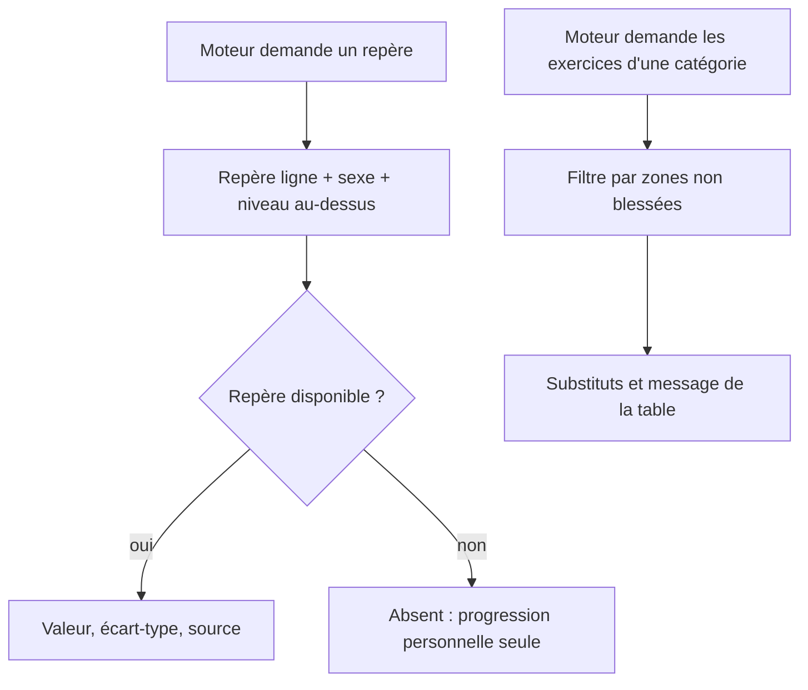
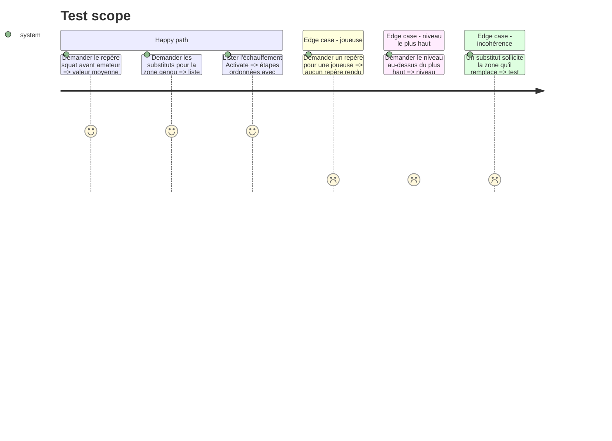

# Instruction: Référentiels sourcés : repères, exercices, substitutions, Activate

## Architecture projection

> Tree of the final files. ✅ create · ✏️ modify · ❌ delete

```txt
.
├── src/
│   ├── types/reference.ts                 ✅ types Norm, Exercise, BodyZone, Substitution, Source
│   └── reference/
│       ├── sources.ts                     ✅ références bibliographiques (auteur, année, DOI) et niveau de preuve
│       ├── norms/
│       │   ├── levels.ts                  ✅ échelle des niveaux de jeu et « niveau au-dessus »
│       │   ├── men.ts                     ✅ repères hommes par ligne et niveau (tableau 3.5 de la veille)
│       │   └── women.ts                   ✅ vide, marqué « repères à venir »
│       ├── exercises/
│       │   ├── library.ts                 ✅ exercices : nom, consignes, catégorie, zones sollicitées, impact
│       │   └── positionEmphasis.ts        ✅ accents par poste (cou piliers, vitesse ailiers…)
│       ├── substitutions/table.ts         ✅ zone → exclus, substituts, message (tableau 8.4)
│       └── activate/warmup.ts             ✅ échauffement de prévention type Activate
└── tests/reference/integrity.test.ts      ✅ cohérence des référentiels
```

## User Journey



## Test Scope



## Tasks to do

### `1)` Repères de performance

> Valeurs de la veille, chacune rattachée à sa source et à son niveau de preuve.

1. Échelle des niveaux de jeu (loisir → pro) et fonction « niveau au-dessus ».
2. Repères hommes par ligne et niveau depuis le tableau 3.5 ; les seniors amateurs rattachés au niveau le plus proche, marqués « estimation ».
3. Marquer « à revérifier » les valeurs issues de Darrall-Jones 2015 et Read 2018.
4. Fichier joueuses vide : la comparaison se désactive.
5. Bronco sans repère.

### `2)` Bibliothèque d'exercices

> Assez d'exercices pour composer force, puissance, vitesse, conditionnement, récupération et prévention.

1. Chaque exercice : catégorie, consignes courtes, zones sollicitées, niveau d'impact, matériel.
2. Accents par poste (cou pour les avants, vitesse pour les arrières…).

### `3)` Substitutions et échauffement

> Tableau 8.4 de la veille et échauffement Activate.

1. Table zone → exercices exclus, substituts, message obligatoire ; commotion marquée « suspension ».
2. Mention « à faire relire par un kiné » dans le fichier et dans l'appli.
3. Échauffement type Activate en étapes ; vérifier les conditions de réutilisation World Rugby avant d'en copier le contenu, sinon le reformuler.

### `4)` Contrôle d'intégrité

> Tests qui empêchent un référentiel incohérent.

1. Tout substitut ne sollicite pas la zone qu'il remplace.
2. Tout exercice cité existe dans la bibliothèque ; toute valeur a une source.

## Test acceptance criteria

| Task | Acceptance criteria |
| ---- | ------------------- |
| 1 | Pour un avant amateur, le repère du niveau au-dessus est rendu avec sa source ; pour une joueuse, aucun repère |
| 2 | Chaque catégorie d'entraînement a au moins trois exercices utilisables sans zone blessée |
| 3 | Pour chaque zone du tableau 8.4, l'appli obtient exclusions, substituts et message ; la commotion renvoie « suspension » |
| 4 | Les tests d'intégrité échouent dès qu'un substitut sollicite sa zone ou qu'une valeur n'a pas de source |
