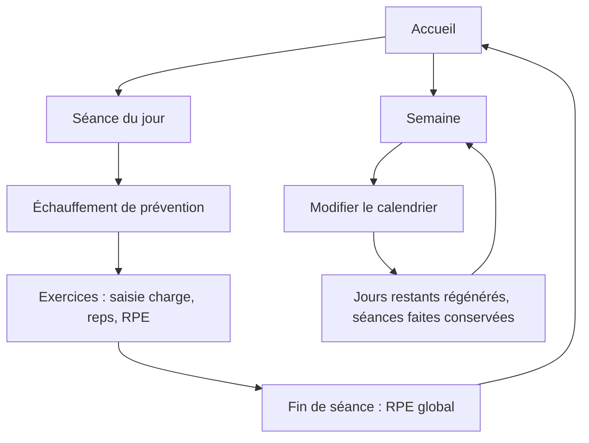
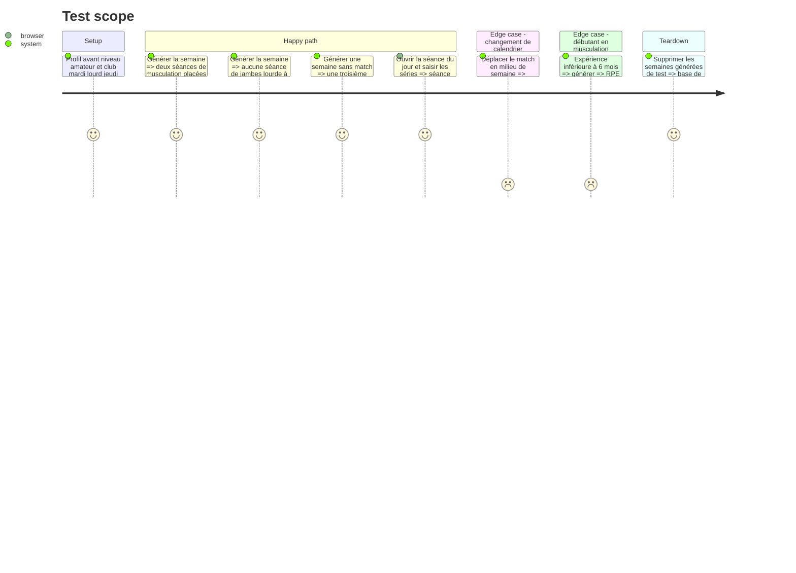

# Instruction: Moteur de semaine, écrans accueil, semaine et séance

## Architecture projection

> Tree of the final files. ✅ create · ✏️ modify · ❌ delete

```txt
.
├── src/
│   ├── types/plan.ts                       ✅ DayPlan, Session, PrescribedSet, LoggedSet, raison de modification
│   ├── engine/
│   │   ├── config.ts                       ✅ constantes et seuils centralisés
│   │   ├── matchDay.ts                     ✅ étiquettes MD±n à partir du calendrier
│   │   ├── week-builder/
│   │   │   ├── buildWeek.ts                ✅ place les séances autour du club et du match
│   │   │   └── composeSession.ts           ✅ contenu d'une séance (échauffement, exercices, RPE cible)
│   │   └── progression/
│   │       ├── level.ts                    ✅ niveau de départ selon expérience muscu
│   │       └── deload.ts                   ✅ semaine allégée toutes les 4 à 6 semaines
│   ├── data/repositories/
│   │   ├── planRepo.ts                     ✅ semaines générées, séances faites conservées
│   │   └── sessionLogRepo.ts               ✅ séries saisies et RPE de séance
│   └── screens/
│       ├── home/                           ✅ séance du jour, ressenti (lien), progression (placeholder)
│       ├── week/                           ✅ vue semaine, navigation, accès calendrier
│       └── session/                        ✅ échauffement, exercices, saisie des séries, fin + RPE
└── tests/engine/
    ├── buildWeek.test.ts                   ✅ règles de placement
    └── composeSession.test.ts              ✅ contenu par poste et niveau
```

## User Journey



## Test Scope



## Wireframe

```txt
Accueil
┌───────────────────────────────┐
│ (1) Bonjour · Lun. MD+2       │
├───────────────────────────────┤
│ (2) Séance du jour            │
│  Muscu A · haut du corps 45'  │
│  [ Commencer ]                │
│  ⓘ allégée : fatigue élevée   │
├───────────────────────────────┤
│ (3) Ressenti du jour          │
│  [ Remplir · 30 s ]  ou  ✓    │
├───────────────────────────────┤
│ (4) Progression               │
│  Squat 140 → 150  ▁▃▅▇        │
├───────────────────────────────┤
│ (5) Accueil·Semaine·Records·⚙ │
└───────────────────────────────┘

Semaine
┌───────────────────────────────┐
│ (1) Semaine du 6 oct · ◀ ▶    │
├───────────────────────────────┤
│ (2) Lun  Muscu A        ✓     │
│     Mar  Club (lourd)  [note] │
│     Mer  Muscu B force        │
│     Jeu  Club          [note] │
│     Ven  Activation légère    │
│     Sam  MATCH   [min · note] │
│     Dim  Récupération         │
├───────────────────────────────┤
│ (3) [ Modifier mon calendrier]│
└───────────────────────────────┘

Séance en cours
┌───────────────────────────────┐
│ (1) Muscu B · force  ◀ quitter│
├───────────────────────────────┤
│ (2) Échauffement Activate  ✓  │
├───────────────────────────────┤
│ (3) Back squat  4×5 @ RPE 8   │
│     117,5 kg · 81 % de ton max│
│     Série 1  [120 kg][5][RPE] │
│     Série 2  [   ][  ][   ]   │
│     ⓘ remplace : fentes (genou)│
├───────────────────────────────┤
│ (4) [ Terminer · RPE séance ] │
└───────────────────────────────┘
```

## Tasks to do

### `1)` Jours relatifs au match

> Étiqueter chaque jour MD±n à partir du calendrier.

1. Calculer MD, MD+1, MD+2, MD-1… ; semaine sans match gérée à part.
2. Deux matchs à moins de 72 h signalés pour la phase 5.

### `2)` Placement des séances

> Règles RC-4.1 à RC-4.4 de la veille.

1. Rien d'intense à MD-1 ni le jour d'un club lourd.
2. Au moins 48 h entre match et force lourde bas du corps ; préférer MD-3.
3. Deux séances de musculation en semaine avec match, trois possibles sans match.
4. Récupération à MD+1, activation légère optionnelle à MD-1, un rappel de vitesse si le club n'en fait pas.

### `3)` Contenu des séances

> Composer chaque séance depuis les référentiels.

1. Échauffement Activate en tête.
2. Niveau de départ par expérience (RC-5.1), prescription en séries × reps @ RPE (RC-5.2).
3. Accents par poste ; semaine allégée toutes les 4 à 6 semaines (RC-5.3).
4. Chaque séance porte un champ « raison » vide, rempli par les phases 5 à 7.

### `4)` Écrans accueil, semaine, séance

> Rendre le plan visible et saisissable hors connexion.

1. Accueil : séance du jour en premier, bloc ressenti (lien), bloc progression (placeholder).
2. Semaine : sept jours typés, navigation, accès au calendrier.
3. Séance : saisie charge, reps, RPE par série ; RPE global en fin ; conservée localement. Charge conseillée en kg affichée par exercice chargé (ajout du 2026-10-02, voir le plan).
4. Modifier le calendrier régénère les jours restants sans toucher aux séances faites.

## Test acceptance criteria

| Task | Acceptance criteria |
| ---- | ------------------- |
| 1 | Pour un match samedi, vendredi est MD-1 et dimanche MD+1 ; deux matchs à moins de 72 h sont signalés |
| 2 | Aucune semaine générée ne place de séance intense à MD-1 ni un jour club lourd, ni de jambes lourdes à moins de 48 h du match |
| 3 | Chaque séance commence par l'échauffement et affiche séries, reps et RPE cible adaptés au niveau et au poste, avec une charge conseillée en kg quand un max est connu |
| 4 | Le joueur voit sa semaine, fait sa séance réseau coupé, et ses séries restent après rechargement |
