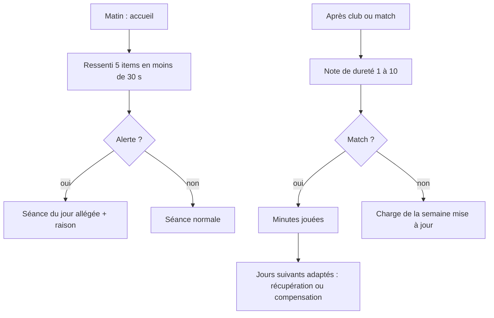
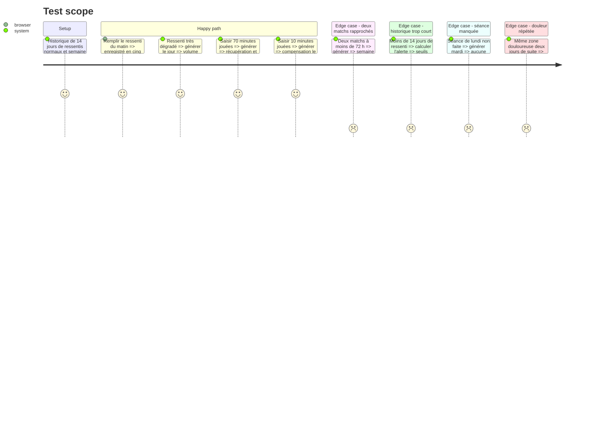

# Instruction: Ressenti, charge, minutes jouées et allègement

## Architecture projection

> Tree of the final files. ✅ create · ✏️ modify · ❌ delete

```txt
.
├── src/
│   ├── types/wellness.ts                   ✅ ressenti 5 items, douleur localisée, note club/match, minutes
│   ├── engine/
│   │   ├── config.ts                       ✏️ seuils d'alerte ajustables
│   │   ├── load/
│   │   │   ├── sessionLoad.ts              ✅ charge = RPE × durée (sRPE)
│   │   │   ├── wellnessScore.ts            ✅ z-score individuel sur base de 14 jours
│   │   │   ├── alerts.ts                   ✅ fatigue, montée rapide, deux matchs < 72 h
│   │   │   └── adjust.ts                   ✅ allègement, pas de rattrapage, raison en une phrase
│   │   └── week-builder/
│   │       ├── buildWeek.ts                ✏️ prend en compte alertes et minutes jouées
│   │       └── compensation.ts             ✅ séances de compensation selon minutes
│   ├── data/repositories/wellnessRepo.ts   ✅ ressentis et notes
│   └── screens/
│       ├── checkin/                        ✅ ressenti du matin, note après club ou match, minutes
│       ├── home/                           ✏️ bloc ressenti actif, raison d'allègement
│       └── week/                           ✏️ boutons note et minutes sur jours club et match
└── tests/engine/
    ├── load.test.ts                        ✅ charge, alertes, allègement
    └── compensation.test.ts                ✅ règles minutes jouées
```

## User Journey



## Test Scope



## Wireframe

```txt
┌───────────────────────────────┐
│ (1) Ressenti du matin         │
├───────────────────────────────┤
│ (2) Fatigue   ① ② ③ ④ ⑤       │
│     Sommeil   ① ② ③ ④ ⑤       │
│     Douleurs  ① ② ③ ④ ⑤       │
│     Stress    ① ② ③ ④ ⑤       │
│     Humeur    ① ② ③ ④ ⑤       │
├───────────────────────────────┤
│ (3) Douleur localisée ? [zone]│
├───────────────────────────────┤
│ (4) [ Valider ]               │
└───────────────────────────────┘
  Variante après club ou match :
  Dureté 1…10 · Minutes jouées
```

## Tasks to do

### `1)` Saisies rapides

> Ressenti en moins de 30 s, note en moins de 10 s.

1. Questionnaire 5 items de 1 à 5, douleur localisée facultative avec zone.
2. Note de dureté 1 à 10 sur les jours club et match, durée pré-remplie.
3. Minutes jouées après un match, en un geste (plages ou curseur).

### `2)` Charge et alertes

> Règles RC-6.1 à RC-6.3, seuils dans `config.ts`.

1. Charge de séance = RPE × durée, cumul journalier, hebdomadaire et 4 semaines.
2. Ressenti en z-score individuel sur 14 jours ; seuils absolus de repli avant 14 jours.
3. Alertes : ressenti dégradé, montée rapide de charge (> +30 % vs moyenne des 3 semaines précédentes), deux matchs à moins de 72 h.

### `3)` Adaptation du plan

> Règles RC-6.4, RC-7.x et RC-8.5.

1. Alerte active : volume −30 à −50 %, pas de RPE ≥ 9, conditionnement intense remplacé par aérobie léger ou mobilité.
2. Minutes : ≥ 60 récupération ; 20–59 récupération légère et compensation courte possible ; < 20 compensation à MD+1 et semaine « sans match » côté musculation.
3. Jamais de rattrapage.
4. Douleur sur la même zone deux jours de suite : retirer les exercices à fort impact sur cette zone.
5. Toute modification remplit la raison affichée en une phrase.

## Test acceptance criteria

| Task | Acceptance criteria |
| ---- | ------------------- |
| 1 | Le ressenti se remplit en cinq touches et la note de séance en une ; tout reste enregistré hors connexion |
| 2 | Un ressenti très en dessous de la base du joueur ou une forte hausse de charge déclenche une alerte ; avant 14 jours, les seuils de repli s'appliquent |
| 3 | Sous alerte, la séance du jour est allégée et l'accueil en donne la raison ; les minutes jouées changent les jours suivants comme prévu ; aucune séance manquée n'est rattrapée |
