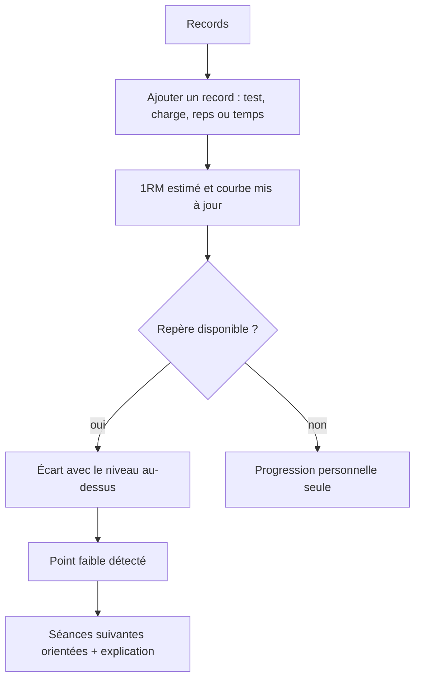
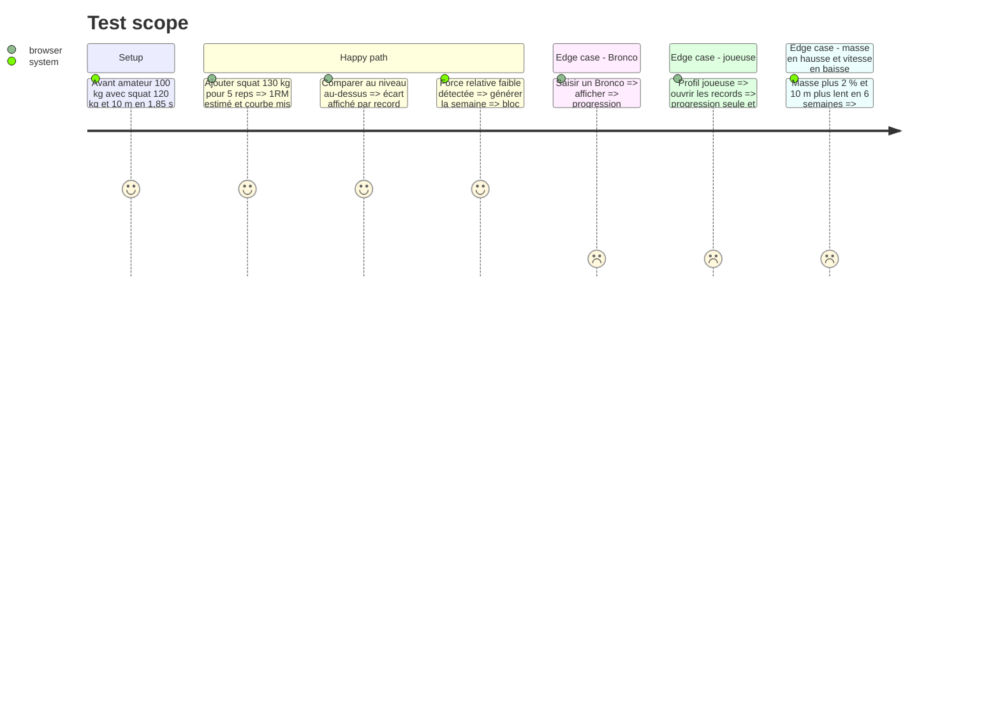

# Instruction: Records, progression et faiblesses

## Architecture projection

> Tree of the final files. ✅ create · ✏️ modify · ❌ delete

```txt
.
├── src/
│   ├── engine/
│   │   ├── progression/
│   │   │   ├── oneRepMax.ts               ✅ 1RM estimé (Epley), conversions 3RM
│   │   │   └── level.ts                   ✏️ niveau qui évolue avec les records
│   │   ├── weaknesses/
│   │   │   ├── compare.ts                 ✅ z-score vs niveau au-dessus, force relative, temps inversés
│   │   │   └── orient.ts                  ✅ faiblesse → bloc force, puissance-vitesse ou hypertrophie
│   │   └── week-builder/composeSession.ts ✏️ intègre l'orientation
│   ├── data/repositories/recordsRepo.ts   ✏️ historique et dernier record par test
│   ├── components/Sparkline.tsx           ✅ mini-courbe sans librairie lourde
│   └── screens/
│       ├── records/                       ✅ liste, ajout, courbe, écart, point faible
│       └── home/                          ✏️ bloc progression réel
└── tests/engine/
    ├── oneRepMax.test.ts                  ✅ formules
    └── weaknesses.test.ts                 ✅ comparaison et orientation
```

## User Journey



## Test Scope



## Wireframe

```txt
┌───────────────────────────────┐
│ (1) Mes records   [+ Ajouter] │
├───────────────────────────────┤
│ (2) Squat     150 kg  ▁▃▅▇    │
│     vs niveau sup. : -0,4 ▼   │
│     Sprint 10m 1,82 s  ▇▅▃    │
│     vs niveau sup. : ok ●     │
│     Bronco   4'52    (perso)  │
├───────────────────────────────┤
│ (3) Point faible : vitesse    │
│     → séances orientées       │
└───────────────────────────────┘
```

## Tasks to do

### `1)` Saisie et historique

> Ajouter un record à tout moment, voir sa courbe.

1. Tests : squat, développé couché, sprint 10 m et 40 m, Bronco, poids, et autres de la bibliothèque.
2. Saisie charge × reps ou temps, date ; 1RM estimé (Epley) affiché.
3. Courbe par test et bloc progression de l'accueil.

### `2)` Comparaison au niveau au-dessus

> Règles RC-3.1 à RC-3.6.

1. Repère ligne + sexe + niveau au-dessus ; au plus haut niveau, son propre niveau.
2. Force rapportée au poids de corps ; z-score, inversé pour les temps.
3. En dessous / dans la norme / au-dessus, avec source consultable.
4. Bronco et joueuses : progression seule.

### `3)` Orientation des séances

> Règle RC-5.5 et protection RC-3.5.

1. Force relative faible → bloc force ; force correcte mais 10 m lent → puissance et vitesse ; masse faible pour le poste → hypertrophie.
2. Masse en hausse avec vitesse en baisse : proposer de la vitesse, pas une faiblesse.
3. Niveau du joueur réévalué quand ses records franchissent les repères de son niveau.
4. Raison affichée dans la séance.

## Test acceptance criteria

| Task | Acceptance criteria |
| ---- | ------------------- |
| 1 | Un record ajouté apparaît aussitôt dans la courbe et sur l'accueil, réseau coupé compris |
| 2 | Chaque record avec repère montre son écart au niveau au-dessus ; Bronco et joueuses n'ont que la progression |
| 3 | Une faiblesse détectée change le contenu des séances suivantes et le joueur voit laquelle et pourquoi |
