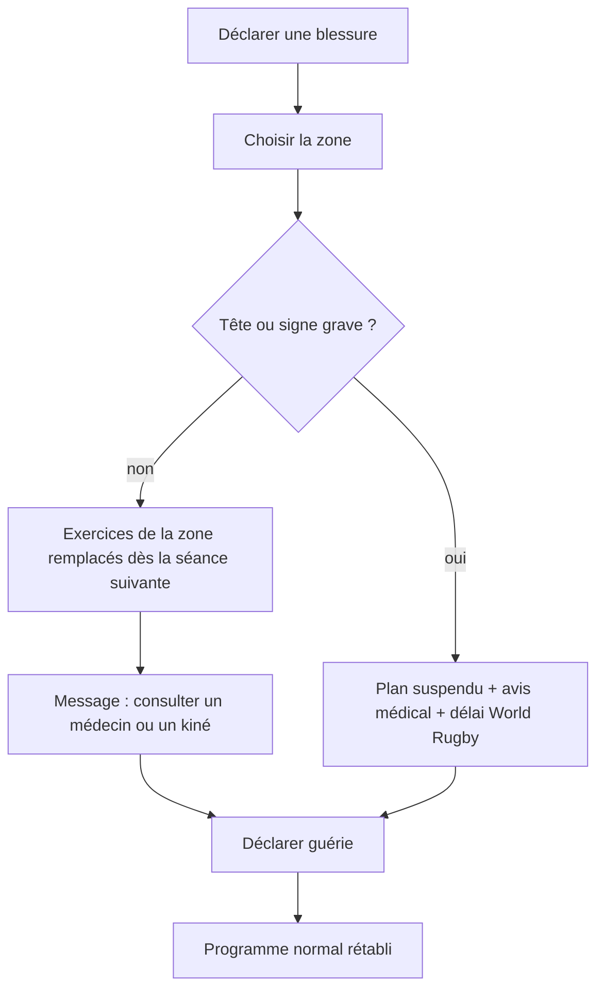
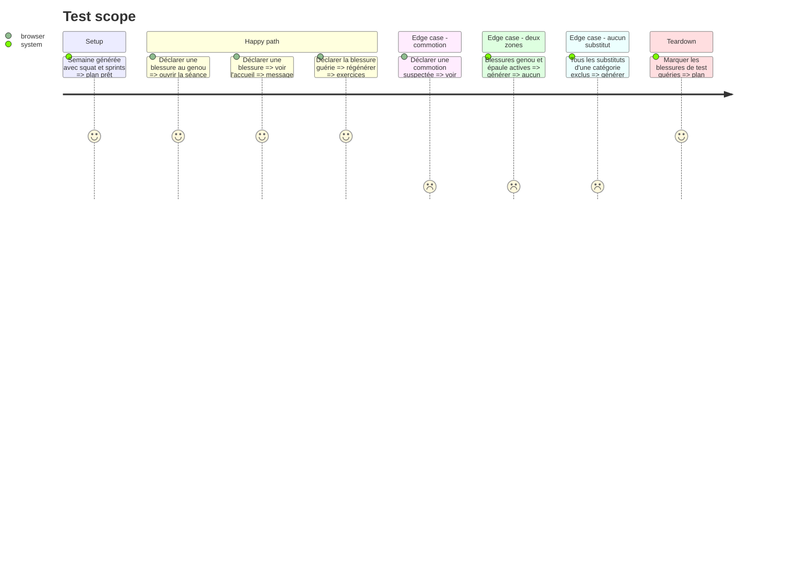

# Instruction: Blessures : exclusion, substitution, commotion

## Architecture projection

> Tree of the final files. ✅ create · ✏️ modify · ❌ delete

```txt
.
├── src/
│   ├── types/injury.ts                     ✅ zone, date, statut active/guérie, signes graves
│   ├── engine/
│   │   ├── injuries/
│   │   │   ├── applyInjuries.ts            ✅ exclusion et substitution d'exercices par zone
│   │   │   └── suspension.ts               ✅ suspension totale (commotion, signes graves)
│   │   └── week-builder/buildWeek.ts       ✏️ applique blessures actives et suspension
│   ├── data/repositories/injuryRepo.ts     ✅ blessures actives et historique
│   └── screens/
│       ├── injuries/                       ✅ déclarer, voir, déclarer guérie
│       ├── session/                        ✏️ mention « remplace … (zone) »
│       └── home/                           ✏️ bandeau renvoi médical, plan suspendu
└── tests/engine/injuries.test.ts           ✅ substitution, suspension, guérison
```

## User Journey



## Test Scope



## Tasks to do

### `1)` Déclaration et suivi

> Déclarer, consulter, guérir.

1. Zones du tableau 8.4 ; question sur les signes graves (perte de connaissance, déformation, appui impossible, symptômes neurologiques).
2. Liste des blessures actives et historique.
3. Retour au programme normal uniquement sur déclaration « guérie ».

### `2)` Exclusion et substitution

> Règle RC-8.4, plusieurs zones cumulables.

1. Retirer tout exercice sollicitant une zone active, le remplacer par un substitut de même catégorie.
2. Sans substitut possible : mobilité ou récupération.
3. Mention « remplace … (zone) » dans la séance, message de consultation sur l'accueil.

### `3)` Suspension

> Commotion et signes graves.

1. Plan entièrement suspendu, bandeau de renvoi médical et délai minimal World Rugby avant de rejouer.
2. Aucune séance proposée tant que la blessure n'est pas déclarée guérie.
3. Rappel « cette appli ne remplace pas un avis médical » et « table à faire relire par un kiné ».

## Test acceptance criteria

| Task | Acceptance criteria |
| ---- | ------------------- |
| 1 | Une blessure déclarée apparaît dans la liste ; la déclarer guérie rétablit le programme normal |
| 2 | Aucune séance générée ne contient un exercice sollicitant une zone blessée active ; chaque remplacement est signalé |
| 3 | Une commotion suspend tout le plan et affiche le renvoi médical jusqu'à la déclaration de guérison |
