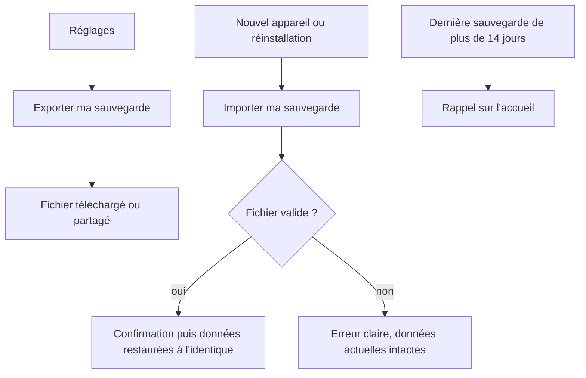
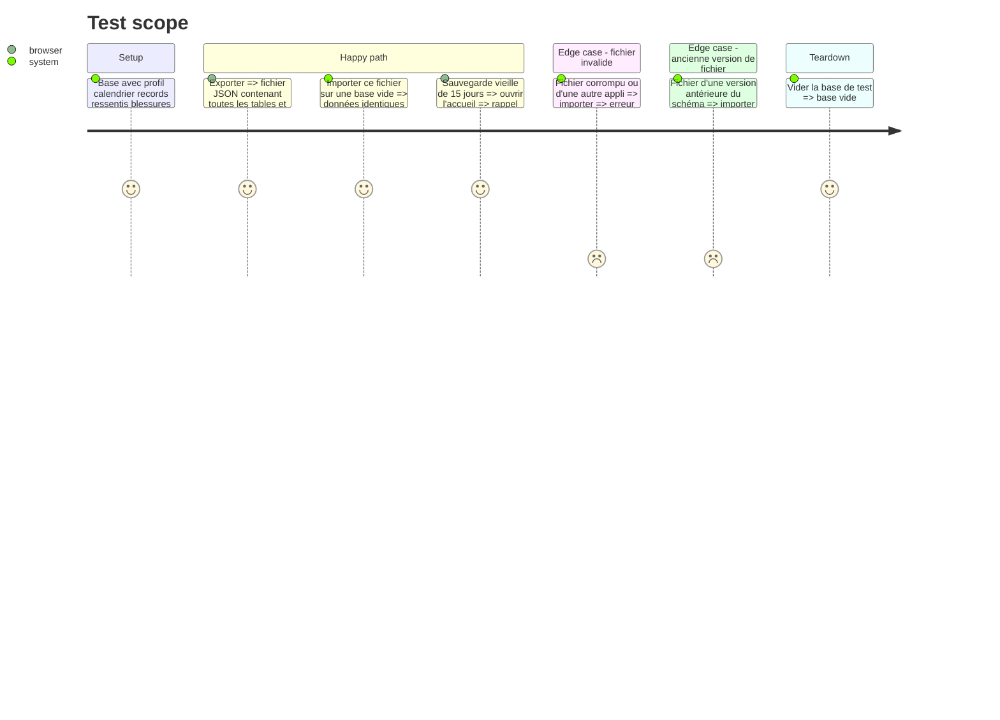

# Instruction: Sauvegarde : export, import et rappel

## Architecture projection

> Tree of the final files. ✅ create · ✏️ modify · ❌ delete

```txt
.
├── src/
│   ├── data/backup/
│   │   ├── exportData.ts                  ✅ toutes les tables en un fichier JSON versionné
│   │   ├── importData.ts                  ✅ validation puis remplacement complet
│   │   └── backupReminder.ts              ✅ date de dernière sauvegarde, rappel à 14 jours
│   └── screens/
│       ├── profile/                       ✏️ boutons exporter et importer, date de dernière sauvegarde
│       └── home/                          ✏️ bandeau de rappel de sauvegarde
└── tests/data/backup.test.ts              ✅ aller-retour, fichier invalide, rappel
```

## User Journey



## Test Scope



## Tasks to do

### `1)` Export

> Un fichier unique qui contient tout.

1. Toutes les tables, y compris les suppressions logiques, avec version du schéma et date.
2. Téléchargement sur ordinateur, partage natif sur téléphone quand disponible.
3. Mémoriser la date de dernière sauvegarde.

### `2)` Import

> Restaurer à l'identique sans risque.

1. Valider format et version avant toute écriture.
2. Confirmation explicite, puis remplacement complet en une transaction.
3. Fichier invalide : erreur claire, aucune donnée modifiée.

### `3)` Rappel

> Filet de sécurité contre l'effacement par Safari.

1. Bandeau sur l'accueil si aucune sauvegarde depuis 14 jours ou jamais.
2. Bandeau masquable jusqu'au lendemain.

## Test acceptance criteria

| Task | Acceptance criteria |
| ---- | ------------------- |
| 1 | Le fichier exporté contient toutes les données du joueur et la version du schéma |
| 2 | Un import sur un autre appareil restaure profil, records, ressentis, blessures et semaine à l'identique ; un fichier invalide ne modifie rien |
| 3 | Sans sauvegarde depuis plus de 14 jours, l'accueil affiche le rappel |
