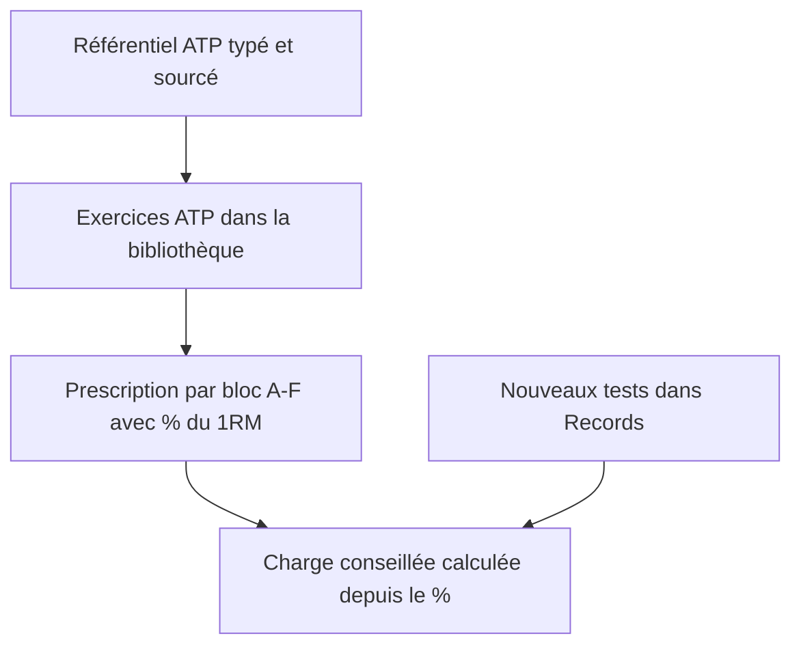
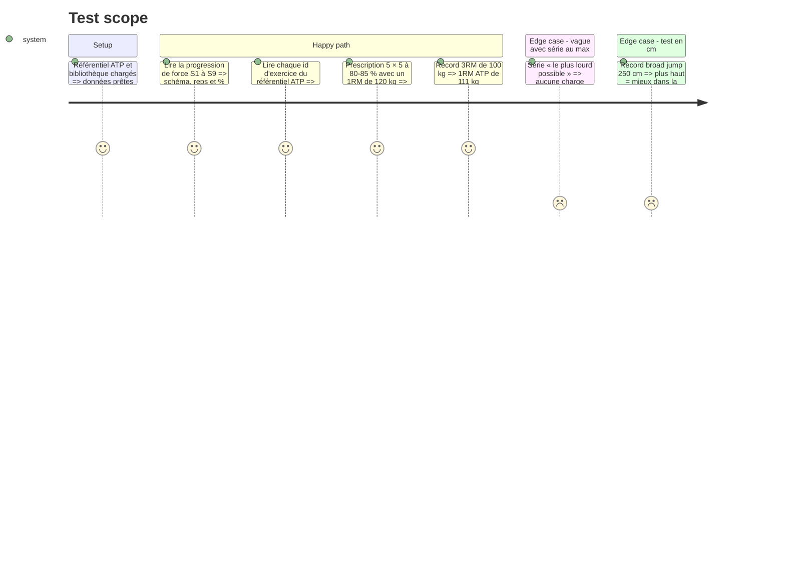

# Instruction: Modèle de séance par blocs, référentiel ATP, exercices et tests

## Architecture projection

> Tree of the final files. ✅ create · ✏️ modify · ❌ delete

```txt
.
├── .gitignore                                   ✏️ exclut le PDF ATP (payant, 155 Mo) du futur dépôt
├── src/
│   ├── types/
│   │   ├── plan.ts                              ✏️ lettre de bloc, superset, facultatif, % du 1RM, vague, récupération
│   │   ├── profile.ts                           ✏️ champ facultatif trainingPhase (saison / intersaison + lundi de départ)
│   │   └── records.ts                           ✏️ tests soulevé de terre, broad jump, T-test, saut latéral G/D ; unité cm
│   ├── reference/
│   │   ├── sources.ts                           ✏️ source ATP Prépa Physique (niveau C)
│   │   ├── exercises/library.ts                 ✏️ exercices ATP manquants (zones, impact, matériel, consignes reformulées)
│   │   └── atp/
│   │       ├── strength.ts                      ✅ progression de force S1-S9 (schémas, %, récup) et version en saison
│   │       ├── conditioning.ts                  ✅ formats de conditioning S1-S9, volume réduit 1re/2e lignes
│   │       ├── field.ts                         ✅ terrain S1-S9 : puissance, COD, sprint, finisher
│   │       └── sessions.ts                      ✅ contenu par type de séance et bloc de 3 semaines, avants / arrières
│   └── engine/progression/
│       ├── oneRepMax.ts                         ✏️ 1RM depuis 3RM (/0,90) et 5RM (/0,84) pour les % ATP
│       └── suggestedLoad.ts                     ✏️ charge depuis un % du 1RM ; rapports soulevé de terre, push press, etc.
└── tests/
    ├── reference/atp.test.ts                    ✅ intégrité du référentiel ATP
    ├── reference/integrity.test.ts              ✏️ nouveaux exercices et tests
    └── engine/suggestedLoad.test.ts             ✏️ charge en % du 1RM
```

## User Journey



## Test Scope



## Tasks to do

### `1)` Modèle de séance par blocs

> Décrire une séance ATP sans casser les séances existantes.

1. `PrescribedExercise` : `group?: 'A'|'B'|'C'|'D'|'E'|'F'` (même lettre = superset), `optional?: boolean`, `restSec?: [min, max]`.
2. `PrescribedSet` : `pctOneRm?: [min, max]` et `waves?: { reps, pctOneRm: [min, max] | null, toMax?: boolean }[]` (une entrée par série pour les vagues 6-4-2-4-6, 5-3-1-3-5, top set + back-off).
3. Ajouter `BlockKind` manquants : `echauffement`, `test`, `finisher`, `terrain`.
4. `Profile.trainingPhase?: { kind: 'saison' } | { kind: 'intersaison'; startMonday: string }` ; absent = saison.

### `2)` Référentiel ATP

> Rendre la méthode ATP lisible par le moteur, reformulée et sourcée.

1. Source `atp-beast-off-season` dans `sources.ts` (ATP Prépa Physique, Math & Louis, programme d'intersaison, niveau C).
2. `strength.ts` : tableau 3.8 du rapport, par semaine, pour squat, développé couché, soulevé de terre ; plus la vague en saison sur 4 semaines + décharge (5 × 5 à 78-82 %, vague 6-4-2, vague 5-3-1, top set 3 + back-off 87-92 %, décharge 3 × 5 à 70 %), 3-4 séries au lieu de 5.
3. `conditioning.ts` et `field.ts` : formats de la section 5 du rapport, volume réduit des postes 1 à 5.
4. `sessions.ts` : par type (lower, upper, conditioning, accessory, field, full, recovery) et par bloc de semaines (S1-3, S4-6, S7-9), les exercices de chaque lettre, avec variante avants / arrières.
5. Aucun texte du PDF copié tel quel, aucun lien vidéo, rien sur les compléments ; les incohérences signalées dans le rapport sont corrigées.

### `3)` Exercices et tests

> Couvrir chaque exercice cité par le référentiel ATP.

1. Ajouter à `library.ts` les exercices ATP absents (push press, soulevé de terre, drop lunge, fentes ATG, SDHP, épaulé + raffût, quadruped row, tractions lestées, cossack, navettes, burpees, Bronco, T-test, triangle COD, sprint multidirectionnel, vélo zone 2, etc.) avec zones, impact et matériel pour les blessures.
2. Records : `souleve-de-terre` (charge), `broad-jump` et `saut-lateral-gauche` / `saut-lateral-droite` (cm, plus haut = mieux), `t-test` (s).
3. Ajouter le PDF ATP au `.gitignore`.

### `4)` Charges en % du 1RM

> Le kg conseillé suit le % prescrit.

1. `oneRepMax.ts` : conversion ATP 3RM → 1RM (/0,90) et 5RM → 1RM (/0,84) pour le bloc force.
2. `suggestLoad` : si `pctOneRm` existe, kg = 1RM × milieu de la fourchette, arrondi vers le bas ; série `toMax` : pas de kg imposé.
3. `LOAD_RATIOS` : soulevé de terre (record propre, sinon 1,2 × squat), push press, fentes, rowing, etc.

## Test acceptance criteria

| Task | Acceptance criteria |
| ---- | ------------------- |
| 1 | Les séances déjà enregistrées (sans `group` ni `waves`) restent lisibles et typées ; le profil sans `trainingPhase` est en saison |
| 2 | Le référentiel donne pour chaque semaine 1 à 9 le schéma de force, le format de conditioning et le contenu terrain du rapport ; la source ATP apparaît dans `sources.ts` |
| 3 | Tout id cité par le référentiel ATP existe dans la bibliothèque avec au moins une zone ; les nouveaux tests sont saisissables dans Records |
| 4 | Une prescription à 80-85 % avec un 1RM de 120 kg donne 97,5 kg ; une série au max n'affiche pas de kg imposé |
