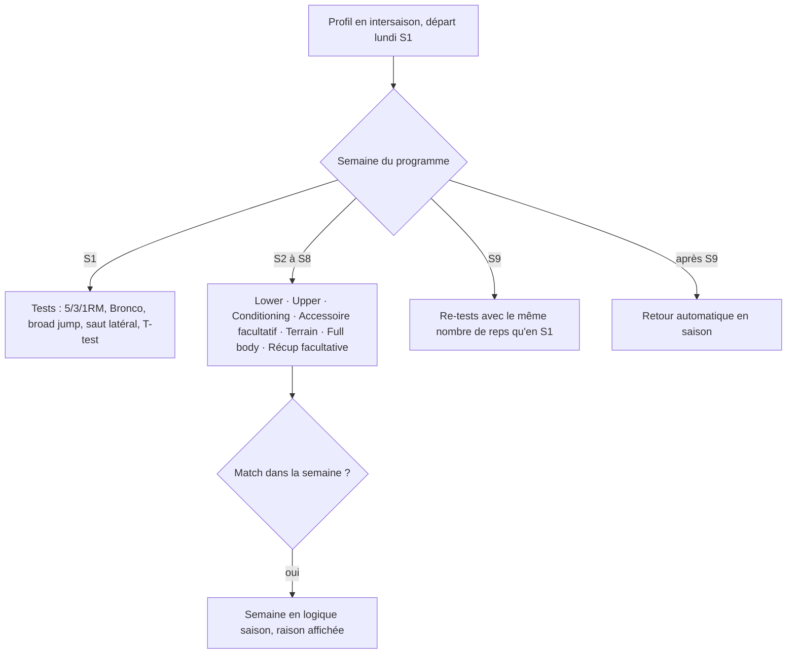
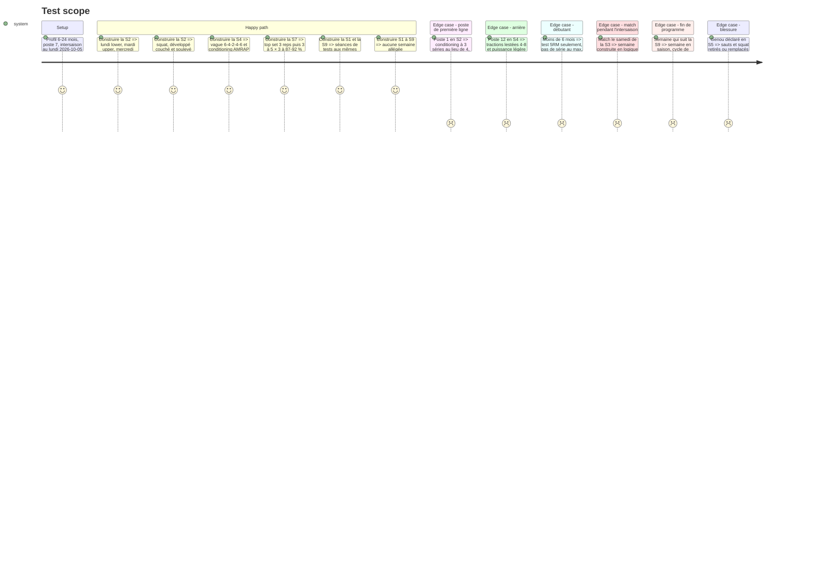

# Instruction: Moteur intersaison : 9 semaines ATP

## Architecture projection

> Tree of the final files. ✅ create · ✏️ modify · ❌ delete

```txt
.
├── src/
│   ├── types/plan.ts                            ✏️ PlanProfile : programWeek (1-9 ou null), sex, slots intersaison
│   ├── engine/
│   │   ├── config.ts                            ✏️ ENGINE_VERSION 3, constantes intersaison
│   │   ├── season.ts                            ✅ semaine du programme depuis trainingPhase (1-9, null hors intersaison)
│   │   └── week-builder/
│   │       ├── buildWeek.ts                     ✏️ branche intersaison : semaine type ATP lundi → dimanche
│   │       ├── composeAtp.ts                    ✅ composition des 7 séances ATP (blocs A-F, niveau, poste, sexe)
│   │       └── composeSession.ts                ✏️ aiguillage des slots intersaison vers composeAtp
│   └── data/repositories/planRepo.ts            ✏️ programWeek dans le profil du moteur et l'empreinte
└── tests/engine/
    ├── offseason.test.ts                        ✅ semaine type, progression S1-S9, avants / arrières, niveaux
    └── buildWeek.test.ts                        ✏️ semaine avec match pendant l'intersaison
```

## User Journey



## Test Scope



## Tasks to do

### `1)` Semaine du programme

> Savoir où en est le joueur dans les 9 semaines.

1. `season.ts` : `programWeek(trainingPhase, weekStart)` = 1 à 9, null avant le départ, après la S9 ou en saison.
2. `planRepo` : `programWeek` dans `PlanProfile` et l'empreinte ; `ENGINE_VERSION` à 3.

### `2)` Semaine type ATP

> Placer les 7 jours ATP dans `buildWeek`.

1. Branche intersaison quand `programWeek` vaut 1 à 9 et que la semaine n'a pas de match : un slot par jour (`atp-lower`, `atp-upper`, `atp-conditioning`, `atp-accessoire`, `atp-terrain`, `atp-full`, `atp-recup`) ; jeudi et dimanche facultatifs.
2. Pas de décharge en intersaison ; les jours de club sont ignorés, avec une raison affichée s'il y en a.
3. Semaine avec match : logique saison actuelle, raison « match pendant l'intersaison ».
4. Contexte (ressenti, charge, blessures, suspension) appliqué comme en saison.

### `3)` Composition ATP

> Construire chaque séance depuis le référentiel de la phase 1.

1. `composeAtp.ts` : blocs A-F (Activate court + 3 tours ATP, puissance, force en % et vagues, supersets D/E, finisher F facultatif) selon la semaine, le bloc de 3 semaines, avants / arrières, le sexe (charges des finishers) et le niveau.
2. Niveau moins de 6 mois : test 5RM seulement, séries au max remplacées par 2 reps à RPE 8, finishers retirés ; plafond de RPE du niveau partout.
3. S1 et S9 : séances de tests, avec en S9 le même nombre de reps qu'en S1 quand le test S1 est enregistré.
4. Durée estimée par séance (salle, terrain, accessoire + vélo) et raisons « Intersaison · semaine n sur 9 ».

## Test acceptance criteria

| Task | Acceptance criteria |
| ---- | ------------------- |
| 1 | Un profil en intersaison depuis le lundi 2026-10-05 est en semaine 3 le 2026-10-19 et repasse en saison le 2026-12-07 |
| 2 | Une semaine d'intersaison sans match contient les 7 séances ATP aux bons jours, aucune n'est allégée, et un match dans la semaine ramène la logique saison avec sa raison |
| 3 | Les schémas de force, formats de conditioning et contenus terrain de chaque semaine correspondent au référentiel ; avants, arrières, débutant et blessure modifient la séance comme indiqué |
