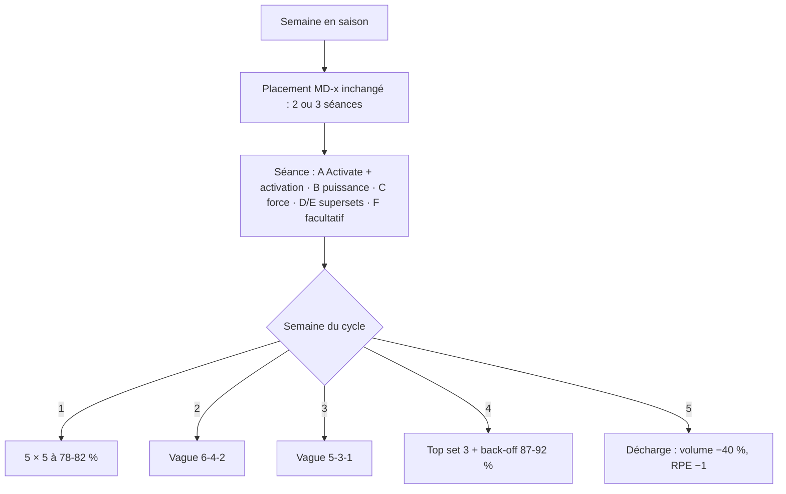
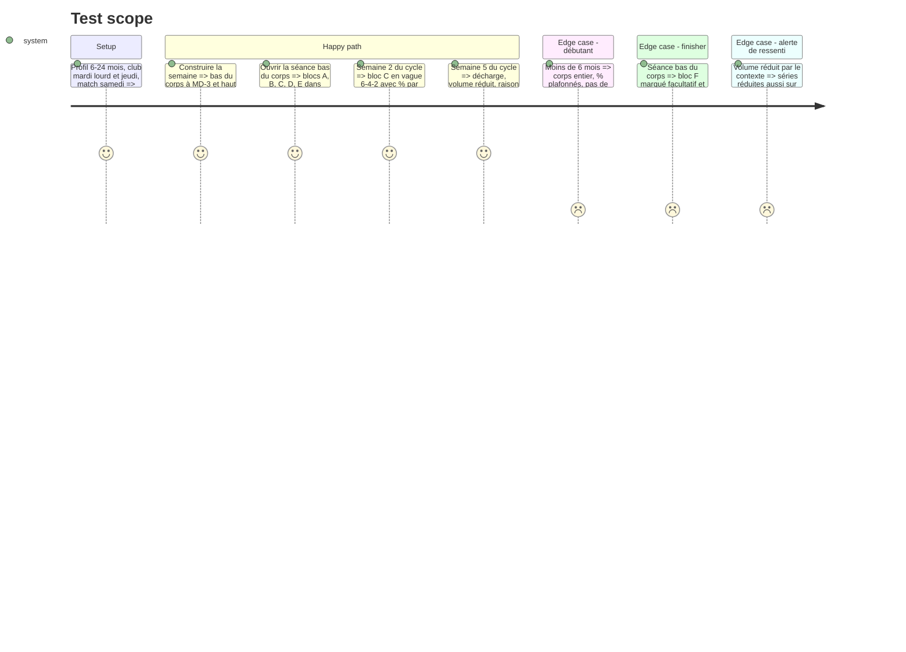

# Instruction: Moteur en saison : structure ATP et vagues de force

## Architecture projection

> Tree of the final files. ✅ create · ✏️ modify · ❌ delete

```txt
.
├── src/engine/
│   ├── config.ts                                ✏️ schémas de la vague en saison, séries réduites
│   ├── progression/strengthWave.ts              ✅ semaine de la vague depuis cycleIndex (1-4, 5 = décharge)
│   └── week-builder/
│       ├── templates.ts                         ✏️ gabarits bas-force, haut, puissance, corps-entier en blocs A-F
│       └── composeSession.ts                    ✏️ lettres, supersets, % et vagues sur le bloc C, finisher facultatif
└── tests/engine/
    ├── composeSession.test.ts                   ✏️ nouvelles formes de séance
    ├── buildWeek.test.ts                        ✏️ placement inchangé, décharge inchangée
    └── strengthWave.test.ts                     ✅ vague sur le cycle de 5 semaines
```

## User Journey



## Test Scope



## Tasks to do

### `1)` Vague de force en saison

> Faire progresser le bloc C d'une semaine à l'autre.

1. `strengthWave.ts` : semaine 1 à 4 de la vague depuis `cycleIndex` ; semaine 5 = décharge existante.
2. Schémas en saison issus de `reference/atp/strength.ts`, 3 à 4 séries selon le niveau, RPE plafond du niveau et du contexte.

### `2)` Gabarits en blocs ATP

> Réécrire les gabarits avec les lettres ATP.

1. A : Activate + 3 tours d'activation ATP propres au slot ; B : puissance (sauts, push press, épaulé) ; C : un mouvement roi ; D/E : supersets de 2 à 3 exercices ; F : finisher facultatif.
2. Accents de poste et orientation par point faible appliqués dans les blocs D/E/B sans dépasser 2 blocs d'accent.
3. MD-2 et plus proche : pas de série au max ni de finisher crosstraining.

### `3)` Tests du moteur

> Adapter les tests de forme sans perdre les règles de placement.

1. Tests de forme réécrits pour les blocs ; placement, 48 h, club lourd, MD-1 et décharge inchangés.

## Test acceptance criteria

| Task | Acceptance criteria |
| ---- | ------------------- |
| 1 | Sur 5 semaines consécutives en saison, le bloc C suit 5 × 5, vague 6-4-2, vague 5-3-1, top set + back-off, puis décharge |
| 2 | Chaque séance de musculation en saison affiche ses exercices groupés A à F, avec des supersets en D/E et un F facultatif ; aucune série au max à MD-2 |
| 3 | Les règles de placement existantes passent toujours ; seuls les tests de forme ont changé |
