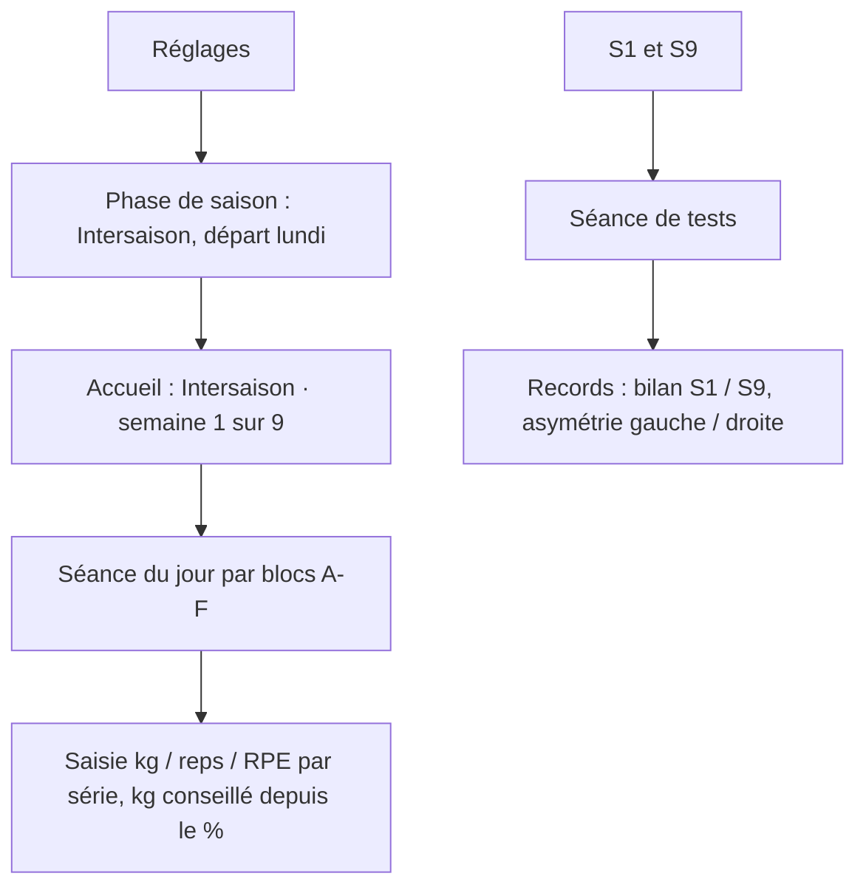
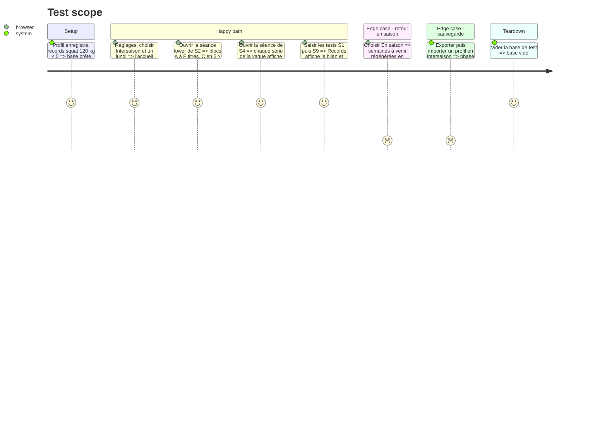

# Instruction: Écrans : phase de saison, séance par blocs, tests et bilan

## Architecture projection

> Tree of the final files. ✅ create · ✏️ modify · ❌ delete

```txt
.
├── src/
│   ├── screens/
│   │   ├── profile/ProfileScreen.tsx            ✏️ section « Phase de saison » : en saison / intersaison + lundi de départ
│   │   ├── home/HomeScreen.tsx                  ✏️ « Intersaison · semaine n sur 9 »
│   │   ├── week/WeekScreen.tsx                  ✏️ badge facultatif sur jeudi et dimanche en intersaison
│   │   ├── session/SessionScreen.tsx            ✏️ en-têtes de blocs A-F, supersets, % et kg par série, récup, F facultatif
│   │   └── records/RecordsScreen.tsx            ✏️ nouveaux tests, bilan S1 / S9 et asymétrie G/D
│   ├── data/backup/importData.ts                ✏️ accepte trainingPhase
│   └── styles/                                  ✏️ styles des blocs et supersets
└── tests/screens/                               ✏️ séance par blocs, réglage de la phase, bilan
```

## User Journey



## Test Scope



## Wireframe

```txt
┌─────────────────────────────────────┐
│ (1) LOWER BODY · S4/9      ◀ Quitter │
│ 70 min · intersaison                 │
├─────────────────────────────────────┤
│ (2) A · Échauffement                 │
│   Activate court ☐ · 3 tours ☐       │
├─────────────────────────────────────┤
│ (3) B · Puissance · récup 1'30-2'    │
│   Drop lunge + amorti   4 × 1/côté   │
├─────────────────────────────────────┤
│ (4) C · Force · Back squat · 2-3'    │
│   S1  6 reps  78-82 %  95 kg [kg][r][RPE] │
│   S2  4 reps  80-85 %  97,5 kg [kg][r][RPE]│
│   S3  2 reps  au max       [kg][r][RPE] │
│   S4  4 · S5 6 …                     │
├─────────────────────────────────────┤
│ (5) D · Superset · récup 1-2'        │
│   D1 Fentes barre dos  4 × 5/côté    │
│   D2 Superman hold     4 × 30 s      │
├─────────────────────────────────────┤
│ (6) F · Finisher (facultatif) ▸      │
├─────────────────────────────────────┤
│ (7) [ TERMINER · RPE SÉANCE ]        │
└─────────────────────────────────────┘

┌─────────────────────────────────────┐
│ (8) Réglages · Phase de saison       │
│   ( ) En saison  (•) Intersaison     │
│   Départ : [lundi 05/10/2026]        │
│   Semaine 1 sur 9 · fin le 06/12     │
└─────────────────────────────────────┘
```

1. En-tête : titre ATP de la séance, semaine du programme, durée.
2. Bloc A : échauffement Activate et tours d'activation ATP, cases à cocher.
3. Bloc B : puissance avec récupération indiquée.
4. Bloc C : une ligne par série de la vague, avec reps, % et kg conseillé.
5. Blocs D/E : exercices du superset numérotés D1, D2.
6. Bloc F : replié par défaut, marqué facultatif.
7. Fin de séance inchangée.
8. Réglages : choix de la phase et du lundi de départ, semaine courante et date de fin.

## Tasks to do

### `1)` Phase de saison dans les réglages

> Laisser le joueur démarrer ou arrêter l'intersaison.

1. Section « Phase de saison » : en saison / intersaison, lundi de départ (lundi courant ou suivant par défaut), semaine courante et date de fin.
2. Accueil : bandeau « Intersaison · semaine n sur 9 » ; semaine : jeudi et dimanche marqués facultatifs.
3. Import de sauvegarde : `trainingPhase` accepté et validé.

### `2)` Séance par blocs

> Afficher et saisir une séance ATP.

1. Groupes par lettre avec titre, récupération et marque superset ; F replié et facultatif.
2. Bloc C : une ligne par série de vague avec reps, % et kg conseillé ; série au max sans kg imposé.
3. Séances de tests : saisie qui renvoie vers Records.

### `3)` Bilan des tests

> Montrer la progression entre S1 et S9.

1. Records : nouveaux tests ; bilan S1 / S9 (écart en kg, cm ou s) et asymétrie gauche / droite du saut latéral.

## Test acceptance criteria

| Task | Acceptance criteria |
| ---- | ------------------- |
| 1 | Choisir Intersaison et un lundi affiche « Intersaison · semaine n sur 9 » sur l'accueil ; revenir en saison régénère les semaines à venir sans toucher aux séances faites ; un export puis un import gardent la phase |
| 2 | La séance montre ses blocs A à F, chaque série d'une vague avec son % et son kg conseillé, et le finisher replié et facultatif |
| 3 | Après des tests S1 et S9, Records affiche l'écart de chaque test et l'asymétrie gauche / droite |
